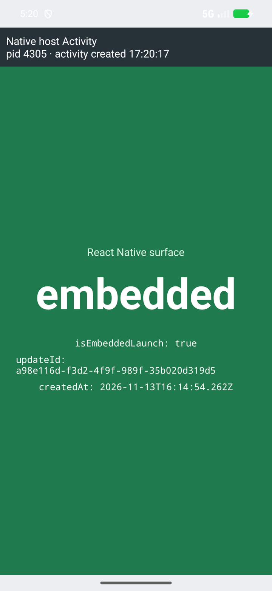
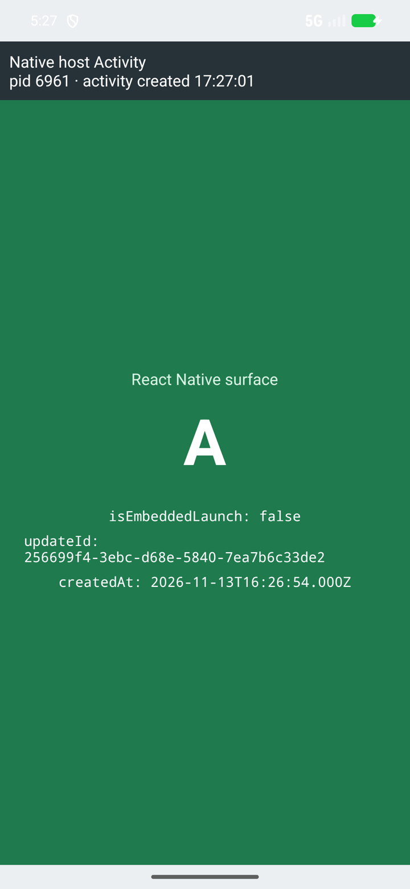
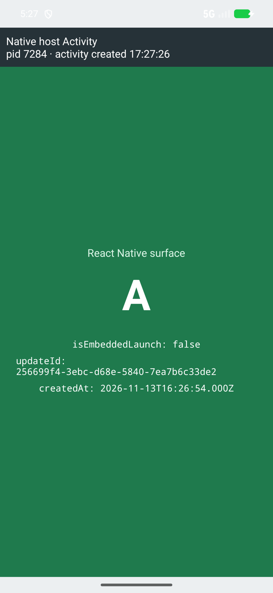
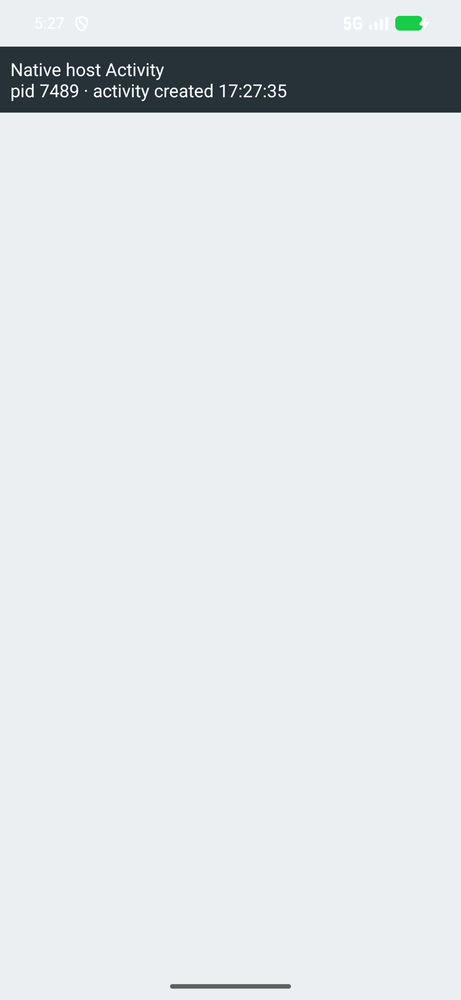
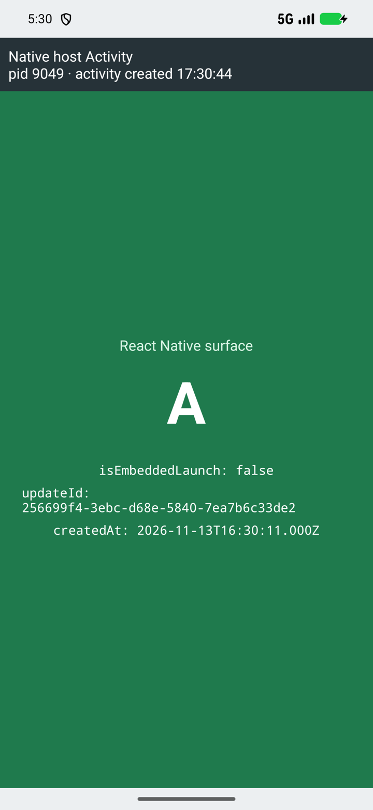
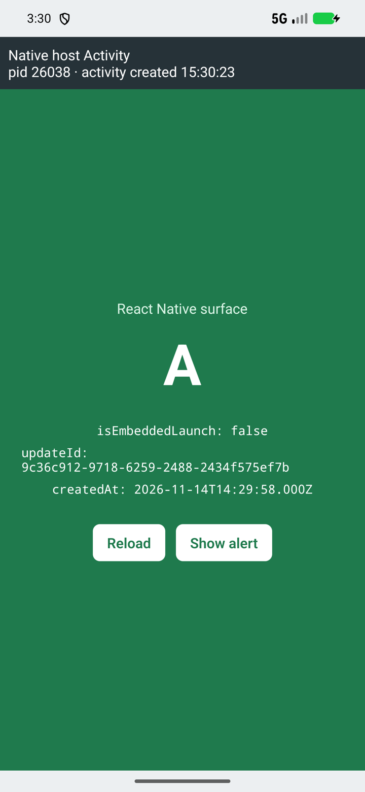
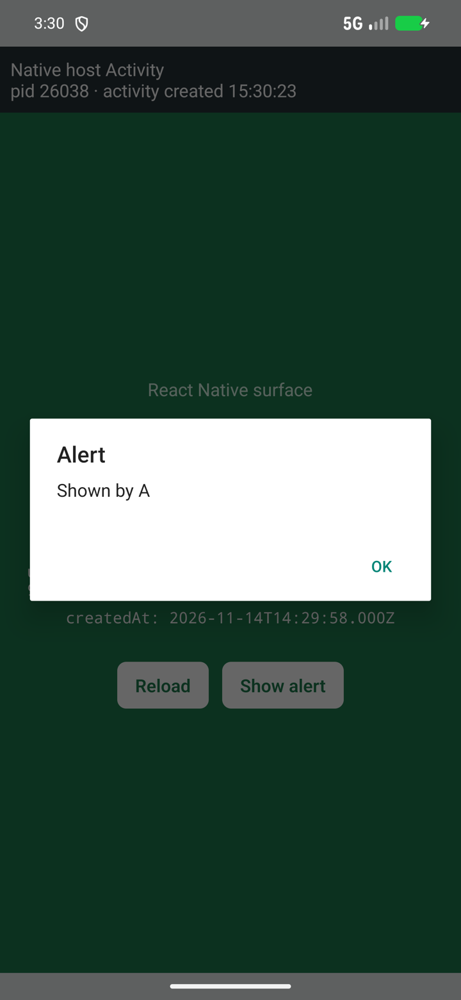
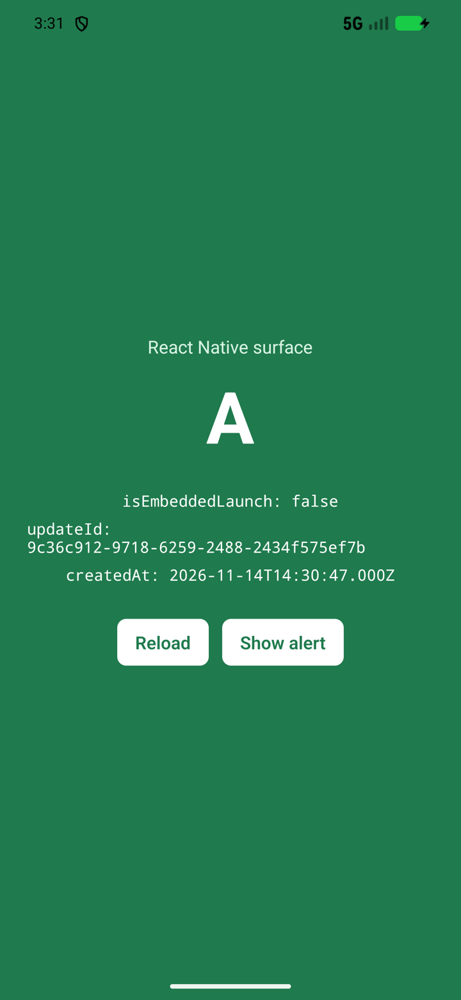
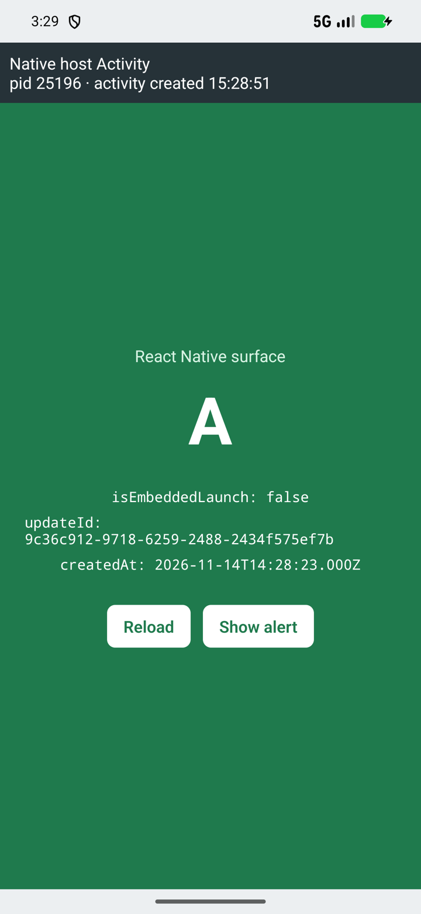

# expo-brownfield + expo-updates on Android: blank surface after error-recovery rollback

A self-contained reproduction of two Android problems in an Expo brownfield setup that uses `expo-updates`:

1. **Bug 1, the main one:** when a downloaded update throws at startup, `expo-updates` error recovery falls back to the previous update in the same process, but the React Native view embedded in the host app stays blank for the rest of the session. Related upstream: the open PR [expo/expo#50943](https://github.com/expo/expo/pull/50943), which targets this startup-crash case for regular apps, and the issue [expo/expo#41543](https://github.com/expo/expo/issues/41543), which is mainly about errors after the recovery window (a different trigger with a similar blank screen).
2. **Bug 2, secondary:** two `pickFirst` lines in `expo-updates/android/build.gradle` override the library's own `excludes`, so the published `expo-updates` AAR ships its own `libc++_shared.so` and `libfbjni.so`. The host app's native-lib merge then fails as soon as that copy differs from React Native's.

Everything uses the latest Expo SDK (58), stock `react-native`, and unpatched packages from npm. Patches are only applied when a build flag asks for them (see [Fixes and flags](#fixes-and-flags)).

## Versions

| | |
|---|---|
| expo | 58.0.25 |
| expo-updates | 58.0.22 |
| expo-brownfield | 58.0.20 |
| expo-modules-core | 58.1.0 |
| react-native | 0.88.1 (New Architecture, bridgeless, Hermes) |
| react | 19.3.0 |
| AGP / Gradle | 9.2.1 / 9.4.1 |
| NDK | 27.1.12297006 (React Native default) |
| Build type | release AAR (`npx expo-brownfield build:android --release`), release host APK |
| Emulator | Pixel 6 Pro AVD, Android 17 (API 37), arm64 |
| Host machine | macOS 27.2, JDK 21, Node 26 |

## Layout

| Path | What it is |
|---|---|
| `rn/` | `create-expo-app` (blank-typescript, SDK 58) + `expo-brownfield` + `expo-updates`. `App.tsx` shows the label, `updateId`, `createdAt` and `isEmbeddedLaunch`, plus two buttons: **Reload** (`Updates.reloadAsync()`, an ordinary reload) and **Show alert** (`Alert.alert`, which needs the host to have a current Activity). `index.ts` throws at module scope when the update is published with `EXPO_PUBLIC_BREAK=1`. The native project is generated by `expo prebuild` and not committed. |
| `host/` | A minimal native Android app (Kotlin). `MainActivity` extends the AAR's `BrownfieldActivity`, shows a native header with the pid and the time the Activity was created, and adds the AAR's `ReactNativeFragment` below it. `DocsExampleActivity` (deep link `repro://docs`) is the Activity from the [expo-brownfield guide](https://docs.expo.dev/brownfield/isolated-approach/) verbatim: `showReactNativeFragment()` in `onCreate`. |
| `server/` | A small Expo Updates protocol v1 server with no dependencies (`server.mjs`): multipart manifests, assets, `noUpdateAvailable` directive, no code signing. `publish.sh <label> [--broken]` runs `expo export` and stores the result as the newest update. |
| `scripts/` | `build-aar.sh` (build and publish the AAR, optional fixes), `scenario-setup.sh` and `run-rollback.sh` (drive the scenario), `classify-rollback.sh` (classify a run from logcat), `adb-device.sh` (device command for the scripts), `logcat-filter.sh`, `caption-video.py` (macOS font path). |
| `fixes/` | The patches and the alternative `ReactNativeViewFactory.kt` used by the build flags. |
| `media/`, `logs/` | Recordings, screenshots, and logcat/Gradle output from the runs described below. The **Reload** / **Show alert** buttons were added after the bug 1 and #50943 recordings, so they only appear in the newer view-factory screenshots. |

## Setup

Requirements: Node 20+, JDK 17+, Android SDK with platform 37 and NDK 27.1.12297006 (`ANDROID_HOME` set, or the default macOS location `~/Library/Android/sdk`), an arm64 emulator (for x86_64 emulators set `ARCHS=x86_64` when building the AAR).

```sh
# 1. JS dependencies
(cd rn && npm install)

# 2. Updates server (keep it running). The emulator reaches it at http://10.0.2.2:3000.
node server/server.mjs

# 3. Build the release AAR and publish it to ~/.m2 (unpatched by default on main)
./scripts/build-aar.sh

# 4. Build and install the host app
(cd host && ./gradlew assembleRelease)
adb install -r host/app/build/outputs/apk/release/app-release.apk
```

The host needs `android:usesCleartextTraffic="true"` only because the local server is plain HTTP.

## Bug 1: blank brownfield surface after an error-recovery rollback

### Steps

1. `./server/reset.sh && ./server/publish.sh A`
2. Cold start the host app. It launches the embedded bundle and downloads A.
3. Cold start again. The surface shows **A**.
4. `./server/publish.sh B --broken` publishes an update whose entry module throws before `registerRootComponent`.
5. Cold start. A still runs, and B is downloaded in the background.
6. Cold start. B is launched and throws.

Steps 1–3 are `scripts/scenario-setup.sh`. `scripts/run-rollback.sh` runs the whole sequence and classifies it from logcat:

- `RECOVERED`: B threw, expo-updates fell back, the host reloaded, and `Running "main"` followed in the same process (with the time from the crash);
- `BLANK`: the same sequence without a `Running "main"` after the reload;
- `INVALID`: the sequence did not happen (B not launched, no fallback, or the process died).

Both scripts take a device command as their second argument. The runs below used the `agent-device` CLI; [`scripts/adb-device.sh`](scripts/adb-device.sh) implements the two subcommands the scripts need (`open`, `screenshot`) with plain adb:

```sh
ANDROID_SERIAL=emulator-5554 ./scripts/run-rollback.sh host/app/build/outputs/apk/release/app-release.apk "$PWD/scripts/adb-device.sh" emulator-5554
ANDROID_SERIAL=emulator-5554 ./scripts/run-rollback.sh host/app/build/outputs/apk/release/app-release.apk "$PWD/scripts/adb-device.sh" emulator-5554 repro://docs   # docs Activity
```

`run-rollback.sh` reinstalls the APK and resets the server's updates each time. The sleeps are fixed (6 s for the download, 12 s for the rollback); a run where B was not downloaded in time comes out as `INVALID`.

### Expected

Error recovery falls back to A and the embedded view shows A in the same process.

### Actual

Error recovery does fall back to A and the React instance is reloaded, but no surface is started on it. The native host Activity stays up (same pid) and the area where the React Native view should be stays empty for the rest of the process. The next cold start shows A again, because B is now marked as failed. With the current `run-rollback.sh`, the unpatched build was `BLANK` in 4 of 4 runs, 2 with each Activity ([`logs/unpatched-runs/`](logs/unpatched-runs/summary.txt)).

### Recording (unpatched)

[`media/bug1-unpatched.mp4`](media/bug1-unpatched.mp4), 44 s: A running → publish B → cold start (B downloads) → cold start (B throws, rollback) → blank surface in the same process → next cold start shows A.

| 1. Embedded launch | 2. Update A | 3. A runs, B downloads | 4. B throws, rollback: blank | 5. Next cold start: A |
|---|---|---|---|---|
|  |  |  |  |  |

### Logcat (unpatched, abridged)

From [`logs/bug1-unpatched-logcat.txt`](logs/bug1-unpatched-logcat.txt) (pid 7489 is the cold start that launches B):

```
17:27:35.421  7489 W BridgelessReact: ReactHost{0}.handleHostException(message = "[runtime not ready]: Error: Intentional module-scope error in a broken update, stack: ...
17:27:35.423  7489 I ReactNativeJS: Running "main"        <- B's runtime; fails with '"main" has not been registered'
17:27:35.425  7489 W BridgelessReact: ReactHost{0}.getOrCreateDestroyTask()
17:27:35.437  7489 I dev.expo.updates: UpdatesErrorRecovery: falling back to older update
17:27:35.487  7489 I dev.expo.updates: Updates state change: Restart
17:27:35.702  7489 W BridgelessReact: ReactHost{0}.getOrCreateDestroyTask(): Stopping all React Native surfaces
17:27:35.703  7489 W BridgelessReact: ReactHost{0}.reload(): Waiting for destroy to finish, before reloading React Native.
17:27:35.726  7489 W BridgelessReact: ReactHost{0}.getOrCreateDestroyTask(): Resetting ReactContext ref
17:27:35.739  7489 W BridgelessReact: ReactHost{0}.getOrCreateReloadTask()
17:27:35.798  7489 W BridgelessReact: ReactHost{0}.getOrCreateReloadTask(): Starting React Native reload
17:27:35.802  7489 W BridgelessReact: ReactHost{0}.raiseSoftException(getOrCreateReloadTask()): ReactContext is null. Reload reason: Restart from RelaunchProcedure
17:27:35.882  7489 W BridgelessReact: ReactHost{0}.getOrCreateReactInstanceTask(): Loading JS Bundle
17:27:35.883  7489 W BridgelessReact: ReactHost{0}.getOrCreateReloadTask(): Restarting previously running React Native Surfaces
17:27:35.883  7489 W BridgelessReact: ReactHost{0}.getOrCreateReloadTask(): Resetting reload task ref
                                     (no further 'Running "main"' in pid 7489)
17:27:52.496  7718 I ReactNativeJS: Running "main"        <- next cold start, new process
```

The `Running "main"` right after `handleHostException` belongs to the crashing B runtime: `AppRegistry.runApplication` is called and fails with `"main" has not been registered`. After the reload to A there is no `Running "main"` in that process.

### Why

1. B's module-scope error reaches `ReactHostImpl.handleHostException()`, which calls `destroy()`. The destroy task stops every attached surface and clears `attachedSurfaces`.
2. expo-updates error recovery runs `RelaunchProcedure` → `ReactHost.restart()` → `reload()`.
3. `getOrCreateReloadTask()` creates a new instance and loads A, then "Restarting previously running React Native Surfaces" iterates `attachedSurfaces`, which is empty, so `AppRegistry.runApplication` is never called.

In a brownfield app the surface belongs to the host's Activity or Fragment (expo-brownfield's `ReactNativeViewFactory.createSurface()` → `ReactDelegate.loadApp()`), and nothing in that chain notices that its surface was stopped.

### With expo/expo#50943 applied

[`fixes/pr-50943/expo-updates-restart.patch`](fixes/pr-50943/expo-updates-restart.patch) is the PR diff, applied to `node_modules/expo-updates` with `PR_50943=1 ./scripts/build-aar.sh`. The PR recreates the Activity once a reload has completed, but only if `restart()` sees `currentReactContext == null` **and** receives a non-null `activity`.

**Result: #50943 is not enough for this brownfield setup.** In 14 runs it brought the surface back once:

| Build | Host Activity | Runs | Surface back in the same process |
|---|---|---|---|
| `PR_50943=1` | `MainActivity` (fragment restored on recreate) | 4 (1 recorded + 3 via `run-rollback.sh`) | 1 (the recorded run) |
| `PR_50943=1` | `DocsExampleActivity` (`showReactNativeFragment()`, as in the docs) | 4 | 0 |
| `PR_50943=1 PR_50943_DIAG=1` | both, alternating | 6 | 0 |

Details are in [`logs/pr50943-repeated-runs.txt`](logs/pr50943-repeated-runs.txt). These runs were classified with an earlier version of `run-rollback.sh` that only printed `RECOVERED` or `BLANK` and did not keep the raw logcat of every run. The diagnostic build logs the values `restart()` sees. All six runs log the same line:

```
Pr50943Diag: restart(): hostWasDestroyed=false activity=null lifecycleState=BEFORE_CREATE
```

so both conditions the PR depends on fail:

- **`hostWasDestroyed=false`:** error recovery calls `restart()` while the destroy task started by `handleHostException()` is still running. The ReactContext ref is reset 1 ms later:

  ```
  17:40:04.969 W BridgelessReact: ReactHost{0}.getOrCreateDestroyTask(): Starting React Native destruction
  17:40:04.973 W Pr50943Diag: restart(): hostWasDestroyed=false activity=null lifecycleState=BEFORE_CREATE
  17:40:04.974 W BridgelessReact: ReactHost{0}.reload(): Waiting for destroy to finish, before reloading React Native.
  17:40:04.974 W BridgelessReact: ReactHost{0}.getOrCreateDestroyTask(): Resetting ReactContext ref
  ```

- **`activity=null`:** `RelaunchProcedure` passes the Activity that `EnabledUpdatesController.onDidCreateReactInstance()` read from `reactContext.currentActivity`, and in these runs that was null.

In the one run where it worked ([`media/pr50943.mp4`](media/pr50943.mp4), [`logs/pr50943-logcat.txt`](logs/pr50943-logcat.txt)), the host Activity was recreated (the header shows a new "activity created" time in the same pid), the restored `ReactNativeFragment` created a new surface, and `Running "main"` followed. That path works with a host that restores its fragment on `recreate()`. With the Activity from the docs, `showReactNativeFragment()` adds a new fragment on every `onCreate`, so a recreate would also need the host to handle `savedInstanceState`. Recreating the host's whole Activity is also a large side effect for a brownfield app, where the Activity belongs to the host and may hold other native UI and state.

| #50943, MainActivity, recorded run: recovered | #50943, docs Activity: blank |
|---|---|
|  |  |

### Fixing it in the brownfield view factory

[`fixes/viewfactory/ReactNativeViewFactory.kt`](fixes/viewfactory/ReactNativeViewFactory.kt) changes only the brownfield template's `createSurface()` (`VIEWFACTORY_FIX=1`, expo-updates unpatched). It is a workaround on the brownfield side, not a fix in React Native or expo-updates. The idea of starting a new surface on the reloaded instance and handing the Activity back to the host and the new context comes from points 1 and 3 of [a comment on #50943](https://github.com/expo/expo/pull/50943#issuecomment-5980397178), which does it through `ReactDelegate.loadApp()`; a brownfield host has no `ReactDelegate`, so here it lives in the factory, which also has to tell a fatal teardown from an ordinary reload on its own:

- Create the surface directly with `reactHost.createSurface(...)` + `surface.start()`, which is what `ReactDelegate.loadApp()` does on bridgeless, and keep a reference to it.
- **Act only on a fatal teardown.** An ordinary reload (`Updates.reloadAsync()`) also runs the before-destroy listeners, but it keeps the surface attached and restarts it itself. `destroy()` differs in that it moves the host to `onHostDestroy()` before the listeners run, which reaches the current `ReactContext`'s `LifecycleEventListener`s; `reload()` only pauses it. The fix watches the current context for `onHostDestroy()` and, in the before-destroy listener, treats the teardown as fatal only if the context being torn down got it. (Checking `reactHost.lifecycleState == BEFORE_CREATE` there instead is not enough: in 1 of 6 runs of an intermediate version the Activity resumed the host between those two steps and the surface stayed blank; those logs were not kept. The check is still used as a fallback.)
- When the next instance comes up and the surface is not running: `surface.stop()` and `waitForCompletion()` on a background thread. If the stop times out, give up and leave the view blank rather than start a surface that a late stop could tear down. Then, on the main thread, start it only if the surface has not been disposed and `reactHost.currentReactContext` is still the new context.
- **Give the Activity back.** `destroy()` resets the host's Activity and the reload resumes the new context without one, and once the host is `RESUMED`, `ReactHost.onHostResume()` no longer reaches the context. So before `start()` the fix calls `reactHost.onHostResume(activity, backHandler)` and `context.onHostResume(activity)` (or does that on the Activity's next `onResume` if it is in the background). Without this, an intermediate version of the fix rendered A again but logged `hasCurrentActivity=false` in all 10 of its runs (those logs were not kept); Activity-dependent APIs such as `Alert` need it.
- Remove all listeners and set a `disposed` flag when the surface is disposed (on the main thread, like the restart).

**Result: the view recovers in the same process in 10 of 10 runs** (5 with `MainActivity`, 5 with the docs Activity), 0.25–0.51 s after the crash, without recreating the Activity. In every run the restarted surface has a current Activity, and tapping **Show alert** afterwards showed the dialog. Per-run results: [`logs/viewfactory-runs/summary.txt`](logs/viewfactory-runs/summary.txt), logcat of the app's processes for each run next to it. For comparison, the unpatched build with the same script was `BLANK` in 4 of 4 runs (2 per Activity, [`logs/unpatched-runs/summary.txt`](logs/unpatched-runs/summary.txt)).

From [`logs/viewfactory-runs/main-1-logcat.txt`](logs/viewfactory-runs/main-1-logcat.txt), pid 26038:

```
15:30:23.658 BridgelessReact: ReactHost{0}.handleHostException(message = "[runtime not ready]: Error: Intentional module-scope error in a broken update, ...
15:30:23.658 ReactNativeJS: Running "main"        <- B's runtime
15:30:23.690 dev.expo.updates: UpdatesErrorRecovery: falling back to older update
15:30:24.043 BridgelessReact: ReactHost{0}.getOrCreateReloadTask(): Restarting previously running React Native Surfaces
15:30:24.052 BrownfieldSurface: React instance recreated after teardown; restarting surface main
15:30:24.075 BrownfieldSurface: Surface main restarted; hasCurrentActivity=true
15:30:24.075 ReactNativeJS: Running "main"        <- A, same process
```

**Ordinary reloads are left alone.** After a recovered run, three `Updates.reloadAsync()` in a row each restarted the surface through React Native's own "Restarting previously running React Native Surfaces", with no `BrownfieldSurface` lines ([`logs/viewfactory-ordinary-reloads.txt`](logs/viewfactory-ordinary-reloads.txt)).

| Recovered (MainActivity) | Alert after recovery | Docs Activity, recovered | After 3 ordinary reloads |
|---|---|---|---|
|  |  |  |  |

`surface.stop()` on the already stopped surface logs a soft exception (`IllegalStateException: Trying to stop surface that hasn't started yet` from `FabricUIManager.stopSurface`), the same one that appears in the #50943 run. It does not crash the app.

Not tested: disposing the surface (leaving the fragment) while a recovery is in progress, several surfaces on one host, and a fatal error while the Activity is in the background.

**Together with #50943.** With both changes in one build (`PR_50943=1 VIEWFACTORY_FIX=1 ./scripts/build-aar.sh`), the view recovered in 10 of 10 runs (5 per Activity), 0.19–0.55 s after the crash, the restarted surface had a current Activity and **Show alert** worked in every run ([`logs/combined-runs/summary.txt`](logs/combined-runs/summary.txt)). The PR's `activity.recreate()` did not run in any of them (no `Schedule relaunch activity` line), so these runs exercise the view factory fix with the PR present, not both acting at once. The case where both act, which happened in 1 of 14 runs with the PR alone, is not tested. Screenshot after recovery: [`media/combined-run-docs-1-recovered.png`](media/combined-run-docs-1-recovered.png).

The recording [`media/viewfactory-fix.mp4`](media/viewfactory-fix.mp4) (33 s) and the screenshots `media/viewfactory-01/02-*.png` were made with the first version of the fix, which did not yet restore the Activity; the rendering recovery they show is the same. Log of that run: [`logs/viewfactory-logcat.txt`](logs/viewfactory-logcat.txt). That first version recovered 6 of 6 runs ([`logs/viewfactory-repeated-runs.txt`](logs/viewfactory-repeated-runs.txt)).

This only covers surfaces created by expo-brownfield's factory. A fix in React Native (keep surfaces attached across a destroy that is followed by a reload) or in expo-updates would cover other embeddings too.

## Bug 2: expo-updates AAR ships its own libc++_shared.so and libfbjni.so

`packages/expo-updates/android/build.gradle` (58.0.22 and `main`):

```groovy
testOptions {
  unitTests.includeAndroidResources = true

  packagingOptions {
    pickFirst "**/libfbjni.so"
    pickFirst "**/libc++_shared.so"
    ...
  }
}
packagingOptions {
  excludes += [
    "**/libc++_shared.so",
    "**/libfbjni.so",
  ]
}
```

`testOptions` has no `packagingOptions`, so the inner block configures the library's normal packaging options, and the `pickFirst` entries override the `excludes` added in [expo/expo#40091](https://github.com/expo/expo/pull/40091). The published `expo.modules.updates-58.0.22.aar` contains:

```
jni/arm64-v8a/libc++_shared.so
jni/arm64-v8a/libexpo-updates.so
jni/arm64-v8a/libfbjni.so
```

### Results

`scripts/bug2-check.sh` builds the AAR in four configurations, lists the `.so` files in the published expo-updates AAR and builds the host app against it. Output: [`logs/bug2-summary.txt`](logs/bug2-summary.txt).

| Configuration | `.so` files in the expo-updates AAR | Host `assembleRelease` |
|---|---|---|
| default NDK (27.1.12297006), unpatched | `libc++_shared.so`, `libexpo-updates.so`, `libfbjni.so` | succeeds |
| `NDK_VERSION=27.0.12077973`, unpatched | `libc++_shared.so`, `libexpo-updates.so`, `libfbjni.so` | **fails** |
| `NDK_VERSION=27.0.12077973 SO_FIX=1` (pickFirst lines removed) | `libexpo-updates.so` | succeeds |
| `NDK_VERSION=27.0.12077973 SO_FIX=2` (pickFirst only for androidTest) | `libexpo-updates.so` | succeeds |

With the default NDK the extra copies are byte-identical to the ones in `react-android` 0.88.1 and `fbjni` (MD5 `d8f40d6f…` for `libc++_shared.so`), and AGP merges identical duplicates without complaint. **So with a stock SDK 58 project the host build does not fail.** It fails as soon as expo-updates' native code is built with a different NDK than React Native's prebuilts. expo-updates honours `rootProject.ext.ndkVersion` since [#45759](https://github.com/expo/expo/pull/45759), so a project that sets another NDK hits it. With NDK 27.0.12077973 the AAR's `libc++_shared.so` has MD5 `cd848a44…` and the host fails:

```
Execution failed for task ':app:mergeReleaseNativeLibs'.
> A failure occurred while executing com.android.build.gradle.internal.tasks.MergeNativeLibsTask$MergeNativeLibsTaskWorkAction
   > 2 files found with path 'lib/arm64-v8a/libc++_shared.so' from inputs:
      - ~/.gradle/caches/9.4.1/transforms/.../transformed/expo.modules.updates-58.0.22/jni/arm64-v8a/libc++_shared.so
      - ~/.gradle/caches/9.4.1/transforms/.../transformed/react-android-0.88.1-release/jni/arm64-v8a/libc++_shared.so
```

`libfbjni.so` is not reported because expo-updates copies it from the `fbjni` prefab package, so it stays identical to React Native's.

Removing the two `pickFirst` lines is enough for the AAR. They probably exist for expo-updates' own instrumentation test APK, though: with `SO_FIX=1` that APK still builds but contains neither `libc++_shared.so` nor `libfbjni.so`, while with `SO_FIX=2` it contains both ([`logs/bug2-androidtest.txt`](logs/bug2-androidtest.txt); the tests were built, not run). [`fixes/so-pickfirst/expo-updates-build-gradle-androidtest-only.patch`](fixes/so-pickfirst/expo-updates-build-gradle-androidtest-only.patch) is therefore the suggested upstream change.

To reproduce by hand:

```sh
NDK_VERSION=27.0.12077973 ./scripts/build-aar.sh && (cd host && ./gradlew assembleRelease)          # fails
SO_FIX=2 NDK_VERSION=27.0.12077973 ./scripts/build-aar.sh && (cd host && ./gradlew assembleRelease) # succeeds
```

## Fixes and flags

On `main`, `scripts/build-aar.sh` builds the unpatched AAR by default. The branch `pr-50943` defaults to `PR_50943=1` and the branch `viewfactory-fix` to `VIEWFACTORY_FIX=1`; pass `PR_50943=0` / `VIEWFACTORY_FIX=0` there to build unpatched. Each run first restores the original expo-updates files (copies are kept in `rn/node_modules/.repro-pristine/`), so a patch from an earlier run never leaks into the next one.

| Flag | Effect |
|---|---|
| `PR_50943=1` | apply [expo/expo#50943](https://github.com/expo/expo/pull/50943) to `node_modules/expo-updates` |
| `PR_50943_DIAG=1` | with `PR_50943=1`, also add the `Log.w("Pr50943Diag", …)` lines from `fixes/pr-50943/diagnostic-logging.patch` |
| `VIEWFACTORY_FIX=1` | replace the generated `ReactNativeViewFactory.kt` with [`fixes/viewfactory/ReactNativeViewFactory.kt`](fixes/viewfactory/ReactNativeViewFactory.kt) |
| `SO_FIX=1` | remove the two `pickFirst` lines from expo-updates' `build.gradle` |
| `SO_FIX=2` | move the two `pickFirst` lines to the androidTest component only (the change proposed upstream) |
| `NDK_VERSION=…` | build the AAR's native code with another installed NDK |
| `ARCHS=…` | ABIs to build (default `arm64-v8a`) |

## Related

- [expo/expo#41543](https://github.com/expo/expo/issues/41543): blank screen after a crash with expo-updates on Android (New Architecture); mostly about errors after the recovery window
- [expo/expo#50943](https://github.com/expo/expo/pull/50943): `[updates][android] Fix stuck splash screen after error recovery relaunch` (open)
- [expo/expo#40091](https://github.com/expo/expo/pull/40091): added the `excludes` for `libc++_shared.so`/`libfbjni.so`
- [expo/expo#45759](https://github.com/expo/expo/pull/45759): expo-updates honours `rootProject.ext.ndkVersion`
